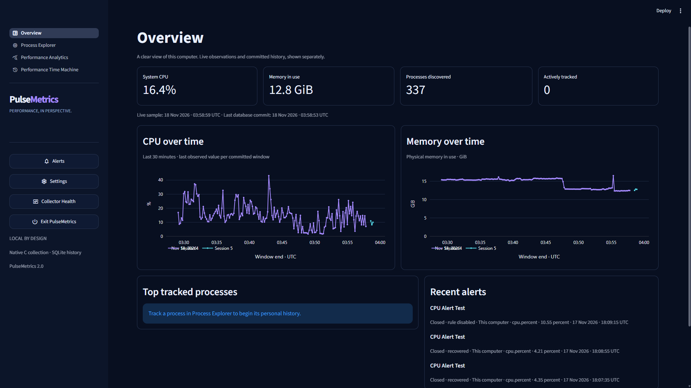
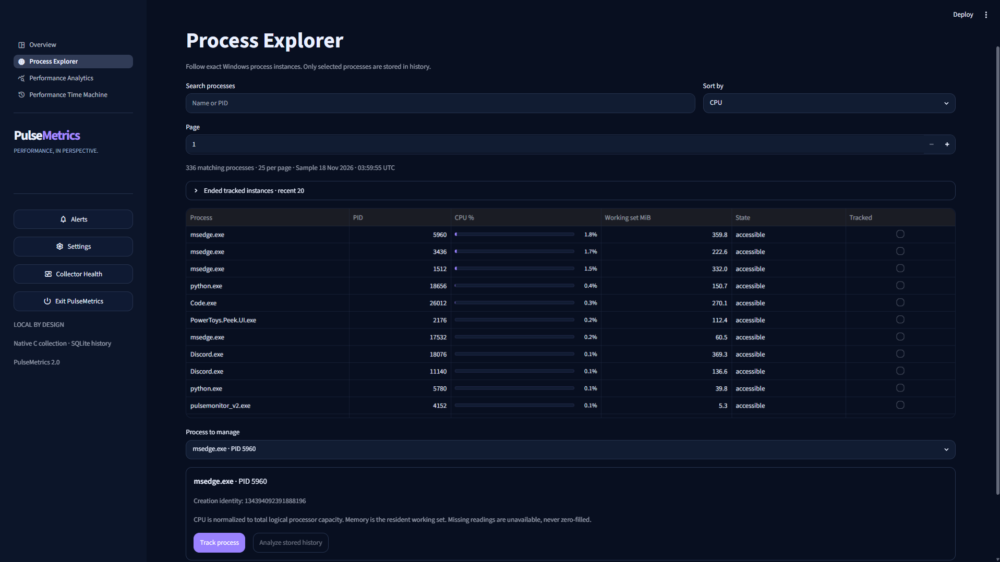
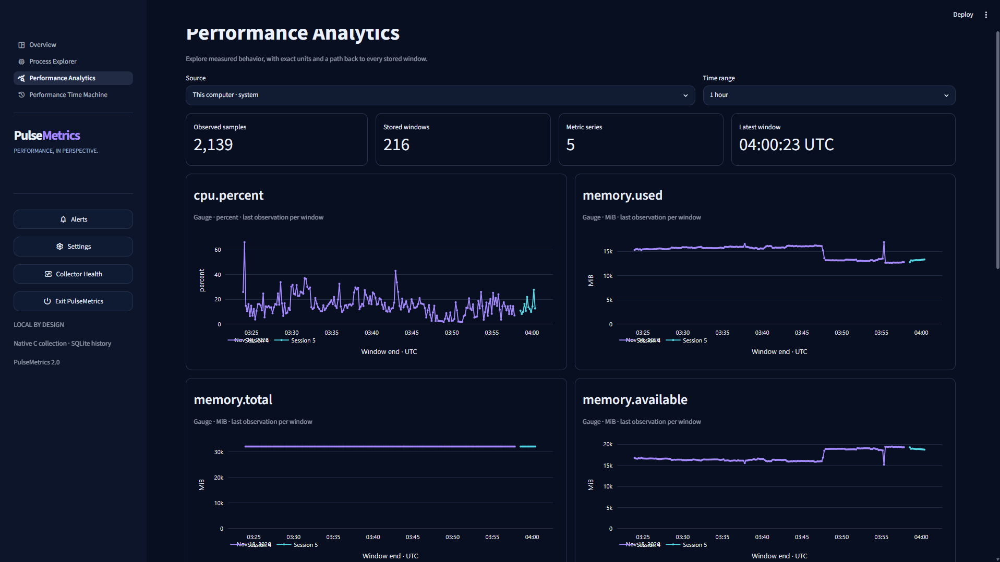
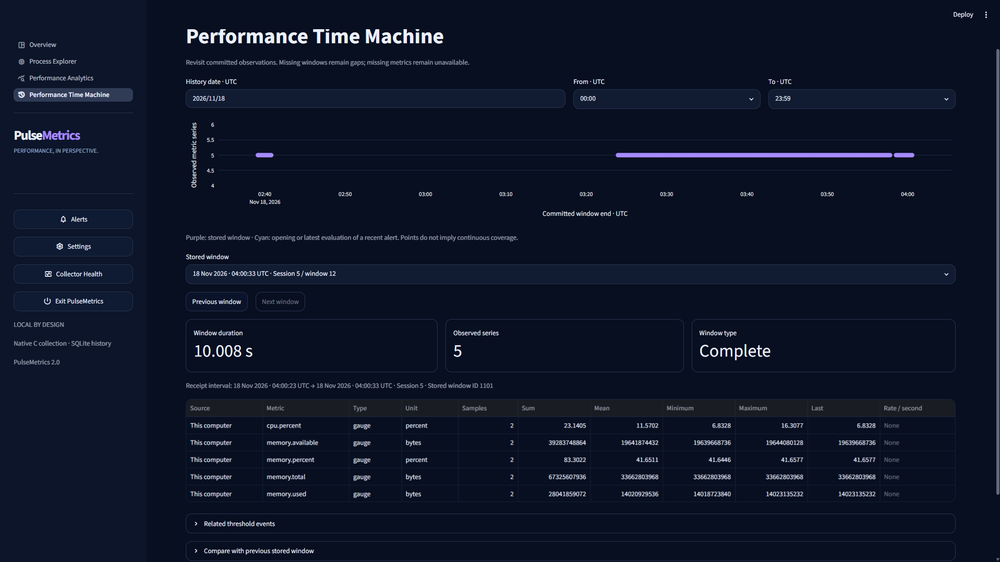
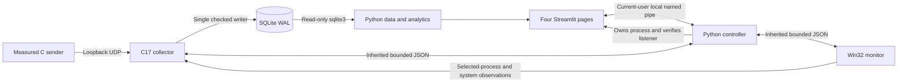

# PulseMetrics 

**Real-time Windows performance monitoring, historical analytics, and threshold-based alerting.**

PulseMetrics is a local-first Windows application that combines a native C17 metrics collector with a Python analytics and presentation layer. It transforms real system, selected-process, and instrumented application observations into live dashboards, alerts, and traceable historical performance windows.

`C17` · `Python` · `Win32` · `Winsock` · `SQLite WAL` · `Streamlit` · `Plotly`

[Features](#features) · [Screenshots](#application-screenshots) · [Architecture](#architecture) · [Getting Started](#getting-started) · [Verification](#verification) · [Contributing](#contributing)



## Features

| Feature | Description |
| --- | --- |
| Overview | Live CPU and RAM usage, resource trends, tracked processes, and collector health. |
| Process Explorer | Discover Windows processes, track or untrack individual process instances, and identify ended or unavailable processes. |
| Performance Analytics | Explore historical metrics by source and time range, including counters, gauges, measured timers, and threshold evidence. |
| Performance Time Machine | Inspect stored aggregation windows, identify historical gaps, and compare compatible performance snapshots. |
| Alerting | Threshold-based alerts, recovery events, and historical supporting evidence. |
| Local-first operation | SQLite history, configurable retention, graceful shutdown and restart, and offline operation after dependencies are installed. |

## Application Screenshots

### Process Explorer

Discover and monitor selected Windows processes with identity-safe tracking and preserved history.



### Performance Analytics

Explore historical CPU and memory observations, metric series, and source-specific trends.



### Performance Time Machine

Inspect stored performance windows and compare historical snapshots using recorded measurements.



The Overview dashboard is shown at the top of this README. See [all four screenshots](docs/screenshots/).

> **Screenshot note:** these captures show the previous interface. The PC-monitoring redesign ([docs/ui-redesign.md](docs/ui-redesign.md)) is implemented but has not yet been captured or manually accepted on a Windows run; recapture before publishing.

## Architecture

PulseMetrics uses a hybrid architecture: native C handles the systems programming core, while Python manages application lifecycle, read-only analytics, and the user interface.



| Layer | Responsibilities |
| --- | --- |
| Native C collector | UDP reception, parsing, validation, aggregation, synchronization, bounded resource usage, alerts, and SQLite persistence. |
| Native Win32 monitor | System sampling, process discovery, and process identity-aware monitoring. |
| SQLite | Local historical storage using WAL mode and a single native writer. |
| Python controller | Process lifecycle management and local inter-process communication. |
| Python analytics and UI | Read-only telemetry queries, historical comparisons, interactive charts, and monitoring dashboards. |

### Technology Stack

| Area | Technologies |
| --- | --- |
| Systems programming | C17, Win32 API, Winsock, UDP |
| Data storage | SQLite, WAL, Python sqlite3 |
| Analytics and visualization | Python, Pandas, Streamlit, Plotly |
| Build toolchain | MSYS2 UCRT64 GCC, CMake, Ninja |
| Testing | CTest, pytest |

See the [architecture documentation, contracts, and ERD](docs/architecture.md) for technical details.

## Getting Started

### Prerequisites

- Windows x64.
- Git, Python, and the MSYS2 UCRT64 native build toolchain (GCC, CMake, and Ninja).
- Access to this repository if it is private.
- Follow the [setup and troubleshooting guide](docs/setup.md) for official installation instructions and tested versions.

### 1. Clone the repository

```powershell
git clone https://github.com/ahmed-mohamed-ref3at/PulseMetrics.git
Set-Location PulseMetrics
```

### 2. Install Python dependencies

Run these commands in PowerShell from the repository root:

```powershell
python -m venv ..\PulseMetrics_V2_ENV
..\PulseMetrics_V2_ENV\Scripts\python.exe -m pip install -r requirements.lock.txt
..\PulseMetrics_V2_ENV\Scripts\python.exe -m pip install -r requirements-dev.txt
```

### 3. Build and launch

```powershell
..\PulseMetrics_V2_ENV\Scripts\python.exe scripts/build.py
..\PulseMetrics_V2_ENV\Scripts\python.exe scripts/launch.py
```

The launcher prints a local loopback URL after server readiness. Open that URL in your browser if it does not open automatically. Use **Exit PulseMetrics** to shut down the application gracefully; closing the browser tab alone leaves collection running.

> **Environment notes:** Use a checkout parent without another PulseMetrics build. The helpers use the sibling `PulseMetrics_V2_BUILD` directory, and an existing CMake cache may refer to another checkout. Do not overwrite another checkout's build evidence. The default toolchain directory is `C:/msys64/ucrt64/bin`, PATH changes are process-local, and runtime data defaults to `%LOCALAPPDATA%/PulseMetricsV2`, outside the source tree.
>
> Offline operation and startup require dependencies to be installed first. Fresh-machine dependency acquisition has not yet been independently verified.

## Verification

Run the existing verification workflow from the repository root:

```powershell
..\PulseMetrics_V2_ENV\Scripts\python.exe scripts/verify.py --configuration Release
```

### Recorded results

| Verification | Recorded result |
| --- | --- |
| Native Release build | Passed |
| Native CTest suites | 2/2 passed |
| Python and integration tests | 14/14 passed |
| Manual acceptance checklist | 15/15 passed — project-lead reported |
| UI/UX acceptance | Previous UI approved by the project lead; redesigned UI pending re-acceptance |
| Offline operation and startup | Passed — project-lead reported |
| Restart and history/settings persistence | Passed — project-lead reported |

Automated results are from the tested delivery candidate. Manual acceptance results were reported separately by the project lead, not independently reproduced by the publication preparation process. Documentation and publication preparation did not rerun or strengthen these test claims.

See [testing documentation and evidence](docs/testing.md) for scope, procedures, and known review items.

## Repository Structure

```text
PulseMetrics/
├── native/                 C collector, core, monitor, sender, tests, vendor
├── python/pulsemetrics/    Controller, IPC, read-only analytics, and UI
├── database/               SQLite schema
├── config/                 Configuration example
├── scripts/                Build, launch, verify, and source packaging
├── tests/                  Python and integration tests
├── docs/                   Architecture, setup, user guide, evidence, course report
│   └── screenshots/       Application screenshots and capture guidance
├── .streamlit/             Approved theme and server defaults
├── requirements*.txt      Direct, runtime-lock, and development dependencies
├── CONTRIBUTING.md         Collaboration guidelines
├── THIRD_PARTY_NOTICES.md  Third-party notices and source provenance
└── README.md               Project overview and quick start
```

## Documentation

- [Architecture and data contracts](docs/architecture.md)
- [Installation and troubleshooting](docs/setup.md)
- [User guide](docs/user-guide.md)
- [Testing and verification](docs/testing.md)
- [Course report](docs/course-report.md)
- [Publication and revision traceability](docs/publication.md)
- [Dependency license metadata](docs/dependency-licenses.md)

## Contributing

Authorized team members can clone the repository, build the application locally, and work on separate feature branches.

```powershell
git switch main
git pull --ff-only origin main
git switch -c feature/your-feature
```

Use a pull request to propose changes to `main` and run the relevant tests before requesting a review. Keep the approved `main` branch stable; do not push changes directly to it without coordination.

Read [CONTRIBUTING.md](CONTRIBUTING.md) for the development and collaboration workflow.

## Known Limitations

- An intermittent alert-to-supporting-window display observation remains unresolved.
- SQLite 3.45.3 emits a retained GCC Release `-Wstringop-overread` warning. Passing tests do not establish that the warning is harmless or that dependencies are vulnerability-free.
- Fresh-machine dependency acquisition and advanced performance benchmarking have not been verified or performed, respectively.
- Multi-processor-group CPU measurements are unavailable. Local UDP is unauthenticated, and V1 history is not imported.
- Three received legacy runtime files differ from their original preservation hashes. The exception remains documented and unwaived; those runtime files are not included in this repository.

## License and Attribution

First-party licensing, publication rights for received and adapted code, and accurate contributor attribution remain subject to confirmation. No first-party license has been selected. Repository access does not itself grant permission to redistribute the code.

[Third-party notices and provenance](THIRD_PARTY_NOTICES.md) preserve the SQLite and modified cJSON notices. [Dependency license metadata](docs/dependency-licenses.md) records locally available Python license declarations.

Original audit evidence is historical and retains original revision identifiers. Publication-history identifiers may differ following authorized privacy sanitization; see [revision traceability](docs/publication.md).

