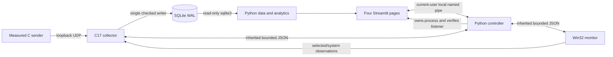
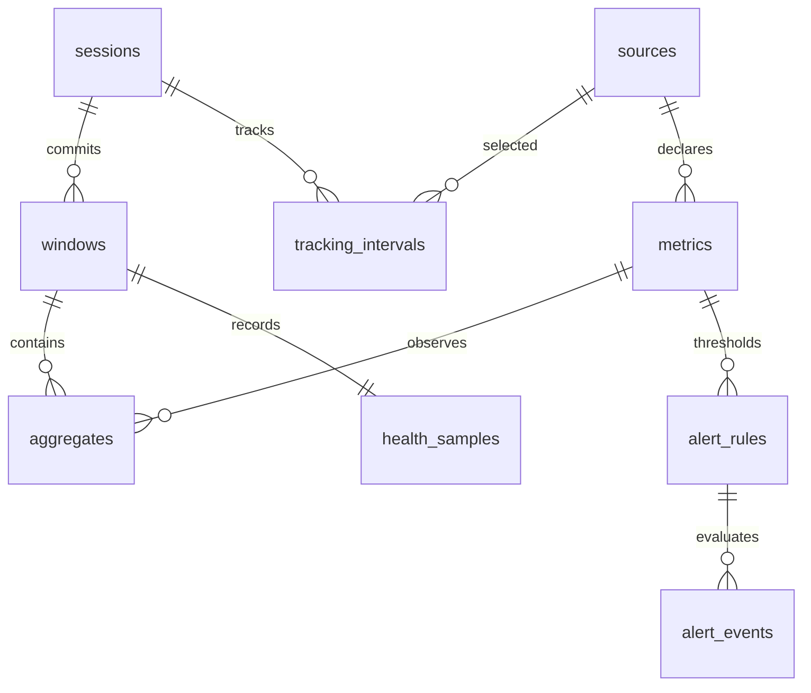

# Architecture and contracts

## Components



Native files are under `native/`; Python modules are under `python/pulsemetrics/`. The collector owns parsing, validation, aggregation, synchronization, resource management, alerts and persistence. Monitor algorithms reuse the received Win32 API approach with corrected process identity, CPU timing and unavailable states. Python never writes the telemetry database. There is no application REST server or generic RPC layer.

Collector threads: main nonblocking Winsock receiver/window owner; bounded stdin control reader; one FIFO SQLite worker. A critical section protects mutable store/control/health state. The worker owns SQLite during concurrent operation; startup bootstrap and final session closure occur before/after its lifetime. Metadata commands copy/commit the candidate store under the lock. This may briefly delay receiving during a busy metadata transaction; UDP loss before receipt cannot be quantified.

The monitor uses Toolhelp32 discovery, GetProcessTimes, GetSystemTimes, GlobalMemoryStatusEx, GetProcessMemoryInfo and QPC. It uses a sampling loop and a bounded control reader, closes handles explicitly and never reads command lines, environments, private memory contents or executable paths. Only system and selected process observations are persisted. Discovery is transient, bounded at10,000 entries; IPC pages contain at most25 rows to keep Unicode records below64KiB.

## Protocol, identity and arithmetic

```text
<source>/<metric>:<finite decimal>|c
<source>/<metric>:<finite decimal>|g
<source>/<metric>:<finite decimal>|ms
```

Example: `app.sender/operations:1|c`. Sources use ASCII letter followed by letters/digits/underscore/dot/hyphen, max64bytes; names use the same grammar, max128bytes. Source/metric declarations are registered before admission. `system` and `p.<pid>.<creation_filetime>` are native sources; external keys begin `app.`. The creation FILETIME is exact64-bit100ns Windows identity, carried as a decimal **string** across JSON. Names/PIDs alone are not identity. Two configured independent sources remain separate even with identical metric names.

Maximum UDP datagram1,200bytes, at most16 lines, max256bytes/line; LF separates lines and final CR is allowed. No tags, sample-rate modifier, client timestamp, gauge-relative delta or backfill. Decimal exponent notation is allowed; hex, whitespace, trailing junk, NUL, non-finite and overflow values are rejected. Absolute values <=1e12; counters/timers nonnegative; percentages0-100; bytes/count nonnegative. Registered type and unit are immutable. No automatic catalog creation from UDP.

Each accepted observation belongs to its collector **receipt-time** window. QPC elapsed time plus a session UTC anchor supplies ordered receipt timestamps. UTC microseconds and actual elapsed microseconds are stored. Counter: observation count, sum, min/max/last; rate=sum/actual window seconds. Gauge: absolute last value plus observed mean/min/max. Timer: actual measured milliseconds, observed mean/min/max and count; timer rate=count/actual seconds. At most1,000,000 observations per series/window and absolute sum<=1e15. Reject before changing state if a bound would be exceeded.

A missing series creates **no aggregate row**. Zero is an actual value, not a missing-data substitute. The chart layer inserts breaks for missing sequence intervals and frozen-buffer gaps, and draws sessions separately. It never stretches observations into repeated history points. Window selection uses stored IDs. Range queries are bounded and explicitly disclose clipping.

## Capacity, persistence and recovery

At most1,024 resident series,100 selected processes,32 configured external sources (32 declarations each, also subject to total series capacity),256 active alert rules,128 native tasks,64 controller child requests and256 cached mutation acknowledgements. Each message is bounded at64KiB and nesting is bounded in C.

Exactly **six immutable pending batches total**, including the batch being written or retried, plus **one active-or-frozen store**. A slot is released only after confirmed COMMIT. When all six slots are occupied at a boundary, freeze the active store; count newly refused lines. On recovery, enqueue that frozen store and start a new window, preserving the pause as a gap. No accepted samples are silently evicted. A batch identity is `(session_id, sequence)`; retries do not duplicate it.

SQLite schema: `database/schema.sql`, embedded at build time. STRICT tables, FK constraints, immutable metric/source identities, immutable committed windows/aggregates, unique open tracking/event constraints and indexes on times and metric/window keys. Runtime bootstrap checks schema version/objects, quick_check and WAL. Existing incompatible databases fail startup; no V1 migration.



Transactions insert window, aggregates, alert transitions and health atomically. SQLITE errors retain the immutable batch for bounded-backoff retry. WAL/FULL and foreign_keys are enabled; busy timeout500ms. Final drain has a10-second budget; a failed drain reports remaining uncommitted samples and a non-clean native result. A crash or forced Job termination can lose uncommitted memory; exit code alone is not proof of a clean shutdown.

Retention performs bounded window deletion (<=500 per pass) after commits, with cascading aggregate/health cleanup, old closed events/interval cleanup, unreferenced disabled rule/process/session pruning and passive checkpointing. Open alert values/timestamps survive expiration of supporting windows (nullable FKs). Retention pauses under a session clock warning. This is an age policy, not a hard database-size guarantee.

Focused corrections implemented:

- **A:** prior active tracking intervals become `interrupted` with NULL end. An interval starting after the last committed window never acquires a fabricated earlier end.
- **B:** AUTOINCREMENT session order determines cross-session alert lifecycle ordering; UTC consistency is checked within one session. Original measurement timestamps are never rewritten. Clock warnings are visible and persisted.
- **C:** verify the owned Streamlit PID's listener and built-in health response before opening a browser. No UI/page-generated readiness notification is required.
- **D:** narrow allowlisted desired-state JSON commands with IDs, acknowledgements/timeouts and explicit errors. No pickle, shell dispatch, arbitrary SQL or generic broker. The controller's named pipe uses a current-user SID ACL, first-instance flag and remote-client rejection. Its reply-read acknowledgement prevents disconnect from discarding an unread response.
- **E:** six-slot accounting includes in-flight/retry work; the independent locked-writer fixture proves accepted data survives unlock exactly once.

## Process and application lifecycle

System CPU uses deltas of kernel+user minus idle (Windows kernel includes idle). Process CPU uses process kernel+user delta divided by actual QPC elapsed and logical processor count, normalized to machine capacity. First sample, counter reset, failed identity/timing or unsupported multi-group topology is unavailable. RAM is physical used/total/available bytes; process memory is resident working-set bytes. UI converts bytes explicitly to MiB/GiB. Neither source measures arbitrary application response time; only an instrumented timer does.

Track: monitor verifies PID+creation -> collector commits source/catalog/interval -> monitor enables sending. A failed enable is compensated by untracking. Untrack: monitor stops sending -> collector disables admission and closes interval; accepted observations remain queued. Confirmed signaled process handles produce Ended. Access denial remains uncertain. Repeated end messages preserve the first recorded end time; delayed batches cannot reopen an ended process's alerts.

Startup: lock runtime -> validate config -> create owning Job -> native collector ready -> monitor ready/revalidate saved identities -> start local Streamlit -> verify owned listener/health -> browser. Saved inaccessible selections remain intent, visible/removable in Explorer; they are not claimed as active measurements.

Exit: stop monitor -> drain/stop collector -> expose and save clean/error result -> UI acknowledges result (or20s deadline) -> close Job/readonly server. Controller failure closes the Job and reaps children. Multiple browser tabs share the same controller/children. Browser tab closure does not stop collection. Restart preserves committed data and restores only independently verified same-instance selections.

Settings are atomically replaced JSON with validated bounds; non-refresh changes require restart. Logs rotate at5MiB with three backups. Only the sender, monitor and collector use metric UDP; all destinations are fixed loopback. Other same-user programs can send forged local UDP, and current-user pipe security is not a hostile-same-user isolation boundary.

## Presentation

Four native Streamlit pages, Plotly only for charts, local dark navy/charcoal theme, cyan/blue measurement accents, teal/green healthy states, orange/red alert and fault states, native widgets/cards/dialogs and app-owned CSS in `python/pulsemetrics/ui/theme.py` (plus a few inline SVG icons). No external fonts, custom JavaScript, animation framework or fabricated chart assets. Live and committed timestamps are distinct. Empty/stale/unavailable/error states are explicit; every value shown comes from the controller status reply or the read-only database.

The PC-monitoring redesign described in [ui-redesign.md](ui-redesign.md) changed only `.streamlit/config.toml`, the theme flags in `controller.py` and `python/pulsemetrics/ui/*`. The native collector/monitor, SQLite schema, IPC, data-access and analytics modules are unchanged. The earlier project-lead acceptance (15/15 manual checks, UI/UX approval) was recorded against the previous purple/cyan UI and has **not** been repeated for the redesign.
